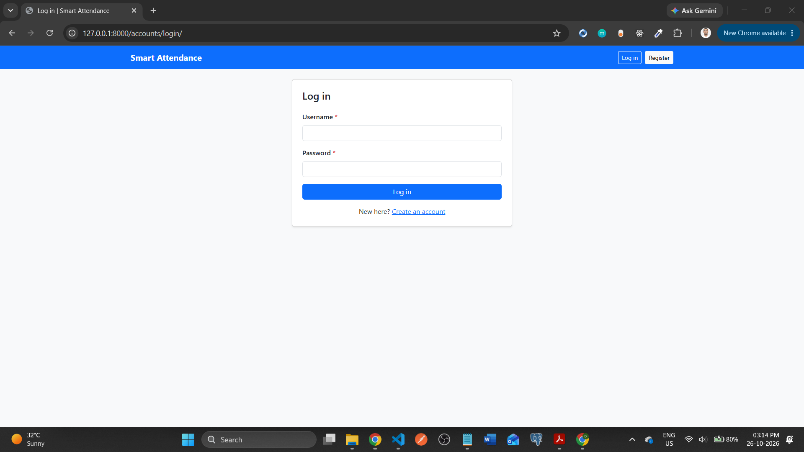
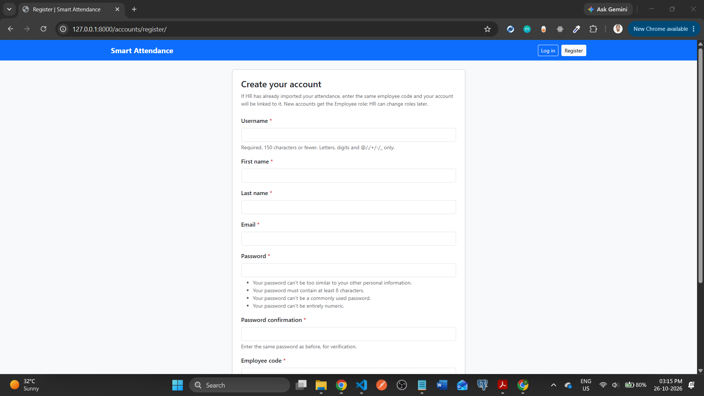
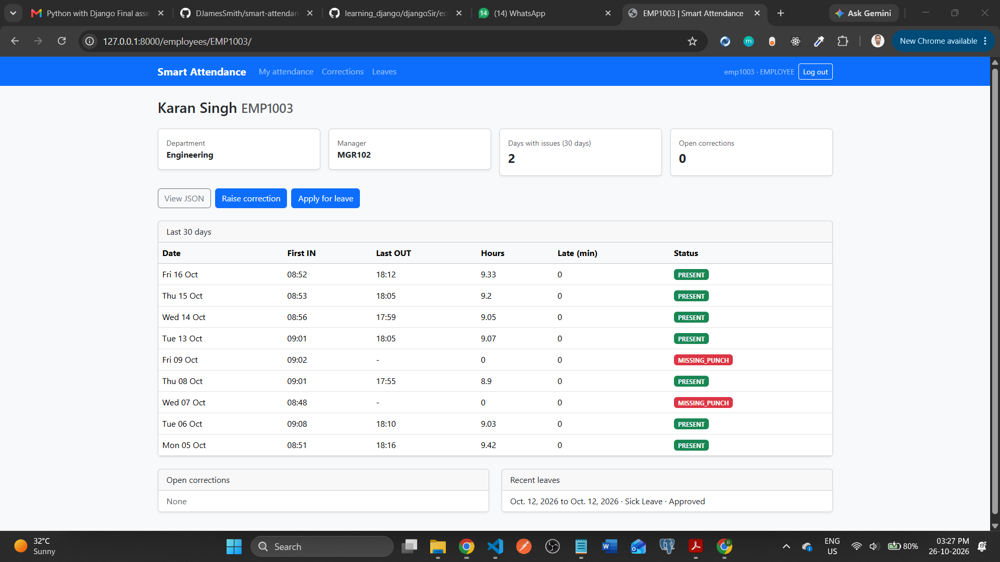
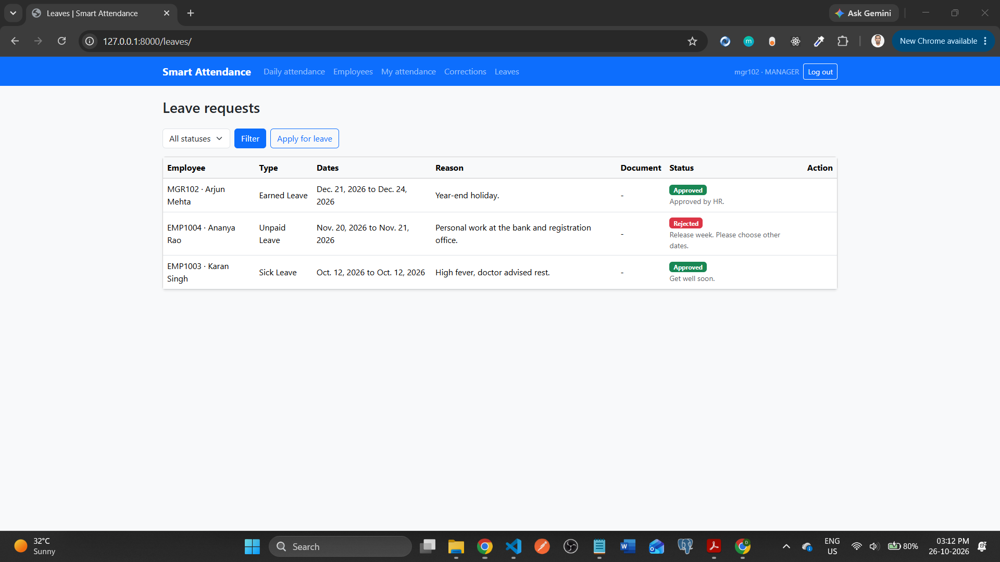

# Smart Attendance, Leave, and Productivity Risk Analytics System

A full-stack Django application for attendance management, leave workflows, attendance anomaly detection, HR correction approvals, and employee attendance-risk analytics.

The project is designed as a locally executable prototype for the Django 5 with ML/AI full-syllabus assessment.

## Table of Contents

- [Project Overview](#project-overview)
- [Objectives](#objectives)
- [Technology Stack](#technology-stack)
- [Core Features](#core-features)
- [System Architecture](#system-architecture)
- [Project Structure](#project-structure)
- [Prerequisites](#prerequisites)
- [Local Installation](#local-installation)
- [Environment Variables](#environment-variables)
- [Database Setup and Migrations](#database-setup-and-migrations)
- [Dummy Data and Demo Users](#dummy-data-and-demo-users)
- [Running the Application](#running-the-application)
- [Screenshots](#screenshots)
- [Celery and Redis](#celery-and-redis)
- [Machine Learning, NLP, and Deep Learning](#machine-learning-nlp-and-deep-learning)
- [API Documentation and Testing](#api-documentation-and-testing)
- [Raw SQL Requirements](#raw-sql-requirements)
- [Sample Data and Test Files](#sample-data-and-test-files)
- [Security and Validation](#security-and-validation)
- [Testing](#testing)
- [Assessment Deliverables](#assessment-deliverables)
- [Implementation Limitations](#implementation-limitations)

## Project Overview

Organizations need reliable attendance records, structured leave management, auditable correction workflows, and early identification of attendance non-compliance.

This system processes employee attendance files, identifies anomalies, supports manager and HR approvals, analyzes employee remarks, and generates attendance-risk predictions.

It provides a server-rendered web interface, secured REST APIs, a PostgreSQL database, asynchronous processing, and locally executable ML/NLP/DL components.

## Objectives

- Import and validate CSV and Excel attendance records.
- Detect duplicate punches, late arrivals, missing punches, and other attendance anomalies.
- Generate daily attendance summaries and correction reports.
- Manage leave requests and attendance corrections through role-based workflows.
- Provide dashboards for department-level attendance analytics.
- Predict attendance non-compliance using machine learning.
- Analyze employee remarks using NLTK.
- Demonstrate risk classification using a minimal TensorFlow/Keras ANN.
- Expose protected APIs for HR administrators, managers, and employees.

## Technology Stack

| Component | Technology |
|---|---|
| Programming language | Python 3 |
| Backend framework | Django 5 |
| Web interface | Django Templates, HTML, CSS, Bootstrap, JavaScript |
| API framework | Django REST Framework |
| Database | PostgreSQL |
| Database access | Django ORM and raw SQL |
| API authentication | JWT or DRF Token Authentication |
| Background processing | Celery |
| Broker and cache | Redis |
| Data processing | NumPy, Pandas |
| Visualization | Matplotlib |
| Machine learning | Scikit-learn |
| Natural language processing | NLTK |
| Deep learning | TensorFlow/Keras |
| API documentation | Swagger/OpenAPI |
| API testing | Postman |

The project runs locally without requiring cloud infrastructure, containers, or external LLM APIs.

## Core Features

### 1. Attendance Processing

- CSV and Excel imports.
- Employee-code and date/time validation.
- Department, punch-type, and device-location normalization.
- Duplicate punch detection.
- Invalid-row handling with custom exceptions.
- Daily summaries, anomaly reports, and correction-required reports.

### 2. HR Workflow Management

- Employee and department management.
- Attendance import batch tracking.
- Attendance correction requests.
- Manager approval or rejection.
- HR finalization of corrections.
- Leave request submission and approval.
- Supporting-document uploads.

### 3. Dashboard and Analytics

- Department-wise late-arrival counts.
- Pending correction counts.
- Leave-request statistics.
- High-risk employee summaries.
- Employee-specific attendance and anomaly details.

### 4. Secured REST APIs

- HR registration, verification, login, and logout.
- Employee listing and attendance information.
- Attendance import status.
- Attendance correction submission and review.
- Manager approval endpoints.
- Risk-score retrieval and prediction.

### 5. Asynchronous Processing

Celery tasks process attendance imports, calculate anomalies, and generate risk scores. Redis acts as the broker and dashboard cache backend.

Task status and failures must be observable through stored progress information or API responses.

### 6. ML, NLP, and Deep Learning

- Train and evaluate at least two Scikit-learn classification algorithms.
- Perform data cleaning, preprocessing, feature engineering, encoding, and evaluation.
- Analyze employee remarks using NLTK tokenization, vectorization, POS tagging, and sentiment or concern classification.
- Train or provide an executable TensorFlow/Keras ANN prototype for attendance-risk classification.
- Expose predictions through a secured API.

## System Architecture

The application follows Django's Model–Template–View pattern, with DRF providing the API layer.

1. Users interact with Django Templates or secured REST endpoints.
2. Django views, forms, serializers, and permission classes validate requests.
3. Django ORM and selected raw SQL queries access PostgreSQL.
4. Celery workers execute long-running imports and analytics tasks.
5. Redis supports task brokering and dashboard caching.
6. ML, NLP, and DL modules process structured attendance data and employee remarks.
7. Results are persisted in PostgreSQL and exposed through dashboards and APIs.

## Project Structure

The following is the proposed repository structure. Application names can be finalized during Phase 1.

```text
smart-attendance-risk-analytics/
├── config/
├── accounts/
├── employees/
├── attendance/
├── leaves/
├── analytics/
├── ml_engine/
├── nlp_engine/
├── deep_learning/
├── templates/
├── static/
├── media/
├── scripts/
├── datasets/
│   ├── input/
│   └── sample/
├── reports/
├── tests/
├── assets/
├── sql_queries.sql
├── notes.txt
├── manage.py
├── requirements.txt
├── .env.example
├── .gitignore
└── README.md
```

The final structure should reflect the actual Django applications and settings modules created during implementation. Generated model files and trained artifacts should be stored separately from source code where appropriate.

## Prerequisites

Install the following locally:

- Python version compatible with the selected Django 5 release.
- PostgreSQL.
- Redis.
- Git.
- A virtual environment.
- Postman for API testing.

Verify the installations:

```bash
python3 --version
git --version
psql --version
redis-cli --version
```

## Local Installation

### 1. Clone the repository

```bash
git clone https://github.com/DJamesSmith/smart-attendance-risk-analytics.git
cd smart-attendance-risk-analytics
```

### 2. Create and activate a virtual environment

macOS/Linux:

```bash
python3 -m venv .venv
source .venv/bin/activate
```

Windows PowerShell:

```powershell
py -m venv .venv
.\.venv\Scripts\Activate.ps1
```

### 3. Install dependencies

```bash
python -m pip install --upgrade pip
python -m pip install -r requirements.txt
```

The requirements file should contain compatible, tested versions of Django, DRF, the PostgreSQL driver, Celery, Redis client, NumPy, Pandas, Matplotlib, Scikit-learn, NLTK, TensorFlow, and the selected JWT and Swagger packages.

### 4. Configure environment variables

Create a local `.env` file using `.env.example` as a template.

Populate the variables with your local configuration before starting the application.

### 5. Create the PostgreSQL database

Open PostgreSQL:

```bash
psql -U postgres
```

Create the database:

```sql
CREATE DATABASE smart_attendance_db;
```

Exit the PostgreSQL shell:

```sql
\q
```

Ensure the database credentials in `.env` match your local PostgreSQL configuration.

## Environment Variables

The `.env.example` file should define the following variables:

```dotenv
DJANGO_SECRET_KEY=replace-with-a-local-secret
DJANGO_DEBUG=True
DJANGO_ALLOWED_HOSTS=127.0.0.1,localhost

DB_NAME=smart_attendance_db
DB_USER=postgres
DB_PASSWORD=replace-with-local-password
DB_HOST=127.0.0.1
DB_PORT=5432

REDIS_URL=redis://127.0.0.1:6379/0

EMAIL_HOST=smtp.gmail.com
EMAIL_PORT=587
EMAIL_USE_TLS=True
EMAIL_HOST_USER=
EMAIL_HOST_PASSWORD=
DEFAULT_FROM_EMAIL=

ACCESS_TOKEN_LIFETIME_MINUTES=30
REFRESH_TOKEN_LIFETIME_DAYS=1
```

These are configuration examples, not production credentials. Implement the corresponding settings in Django and validate them at startup. Use a separate local `.env` file for actual secrets; never commit it.

Email settings are required only if email-based verification is selected. Token lifetime variables must be wired to the chosen authentication implementation.

## Database Setup and Migrations

After configuring the database:

```bash
python manage.py check
python manage.py makemigrations
python manage.py migrate
python manage.py createsuperuser
```

Review generated migrations before applying them. Commit the migration files to Git so the evaluator can recreate the schema reliably.

## Dummy Data and Demo Users

Two helper scripts live in the `datasets/` folder. Run them after `python manage.py migrate`:

```bash
cd datasets
python seed_data.py
python generate_sample_data.py
cd ..
```

- `seed_data.py` inserts dummy records into PostgreSQL: departments, shift rules, users with employee profiles (HR Admin, Managers, Employees), and leave requests. It is safe to run more than once; existing records are updated, not duplicated.
- `generate_sample_data.py` recreates the sample attendance files in `datasets/sample/` (`attendance_sample.csv`, `attendance_sample.xlsx`, and the edge-case files). Upload `attendance_sample.csv` from the web app to import attendance for the seeded employees.

### Demo user password

> **Every dummy user created by `seed_data.py` has the password `Demo@12345`.**
>
> This password exists only because this is dummy data for testing and evaluation. The application itself never assigns passwords: real users choose their own on the Register page, and the superuser password is the one you enter in `createsuperuser`. All passwords are stored as Django password hashes (`pbkdf2_sha256$...`), never as plain text.

| Username | Role | Department |
|---|---|---|
| `hra001` | HR Admin | Human Resources |
| `mgr101` | Manager | Customer Support |
| `mgr102` | Manager | Engineering |
| `emp1001`, `emp1002` | Employee | Customer Support |
| `emp1003`, `emp1004` | Employee | Engineering |
| `emp1005` | Employee | Human Resources |

To reset every user (including any registered later) to the demo password, run from the project root:

```bash
python manage.py shell -c "from accounts.models import User; users = list(User.objects.all()); [user.set_password('Demo@12345') for user in users]; User.objects.bulk_update(users, ['password']); print(len(users), 'passwords set to Demo@12345')"
```

Note that this also resets the superuser's password.

## Running the Application

### Django development server

```bash
python manage.py runserver
```

Open `http://127.0.0.1:8000/accounts/login/` to log in, or `http://127.0.0.1:8000/accounts/register/` to create an account.

### Django administration

Open `http://127.0.0.1:8000/admin/` and sign in with the superuser credentials created locally.

### Static files and media

During development, configure Django to serve static assets and uploaded media correctly. Do not commit real employee documents or sensitive attendance records.

## Screenshots

Replace each placeholder image with a real screenshot saved in `assets/screenshots/` using the same file name.

### Login


### Register


### Daily attendance


### Leave requests


## Celery and Redis

Start Redis locally using the installation method appropriate for your operating system.

Verify connectivity:

```bash
redis-cli ping
```

Expected response:

```text
PONG
```

Start the Celery worker from the repository root, using the actual Django project package containing the Celery application:

```bash
celery -A config worker --loglevel=info
```

Replace `config` if the final project package has a different name.

The Django application and Celery worker must run in separate terminals. Attendance imports, anomaly calculations, and risk-score generation should execute through background tasks rather than block HTTP requests.

## Machine Learning, NLP, and Deep Learning

### Machine Learning

Use Pandas and NumPy for preprocessing and Scikit-learn pipelines for training and inference.

Candidate features:

- `late_count`
- `absent_count`
- `correction_count`
- `leave_count`
- `average_delay_minutes`
- Encoded department

Train and evaluate at least two classifiers from Logistic Regression, Random Forest, SVM, Naive Bayes, and KNN.

Document the target-label definition, train/test strategy, evaluation metrics, and limitations. Avoid data leakage when constructing training features.

### Natural Language Processing

Use NLTK to tokenize employee remarks, vectorize text, perform POS tagging, and classify sentiment or concern categories.

NLTK data resources must be downloaded separately when required. Document the required resources and their installation commands.

### Deep Learning

Implement a minimal executable TensorFlow/Keras ANN for risk classification. Document its input features, preprocessing, training process, evaluation, and inference interface.

Keep the ML and ANN inference pipelines consistent with the feature schema used during training.

## API Documentation and Testing

Configure Swagger/OpenAPI using a compatible documentation package.

The API documentation should cover:

- Authentication and token handling.
- Employee listing.
- Attendance import status.
- Attendance correction workflows.
- Manager approval.
- Risk-score retrieval and prediction.

Use Postman to verify successful requests, validation failures, expired or invalid tokens, unauthorized access, and role-specific permissions.

Commit a sanitized Postman collection and relevant screenshots as assessment evidence.

The final endpoint URLs depend on the implemented URL configuration; document the actual routes rather than assuming predefined paths.

## Raw SQL Requirements

Maintain `sql_queries.sql` in the repository root.

It must demonstrate the required SQL concepts using the actual schema:

- `SELECT`, `WHERE`, `AND`, `OR`, and `LIKE`.
- `BETWEEN`, `LIMIT`, and `ORDER BY`.
- `FETCH` versus `LIMIT`.
- Aggregate functions: `COUNT`, `SUM`, `MIN`, `MAX`, and `AVG`.
- `GROUP BY` and `HAVING`.
- `INNER JOIN` and `FULL OUTER JOIN`.
- `NATURAL JOIN`, where appropriate.
- `UNION ALL` and `INTERSECT`.

Use meaningful attendance-related examples. Explain schema-specific assumptions and handle SQL dialect differences appropriately.

## Sample Data and Test Files

Provide sanitized sample CSV/Excel attendance data and, where relevant, a sample supporting-document file.

Include test cases for:

- Missing required columns.
- Empty or unsupported files.
- Duplicate records.
- Invalid employee codes and timestamps.
- Missing optional fields.
- Invalid numeric values.
- Attendance anomalies and correction workflows.
- Authentication, authorization, and task failures.

Never include real employee personal information in public sample files.

## Security and Validation

- Enforce role-based access for HR administrators, managers, and employees.
- Require verification before activating HR administrator accounts.
- Validate uploaded files, columns, formats, and record values.
- Use Django CSRF protection for browser-based form submissions.
- Secure APIs using the selected authentication scheme and custom permissions.
- Prevent unauthorized correction, approval, and employee-data access.
- Keep secrets out of source control.
- Handle task failures and repeated ML/NLP/DL execution without corrupting existing records.

## Testing

Run the Django system checks and automated tests:

```bash
python manage.py check
python manage.py test
```

Also verify the database migrations, background tasks, file-import reports, dashboard analytics, API permissions, and model inference flows.

## Assessment Deliverables

The repository must include:

- Complete Django project source code.
- `README.md` with setup and execution instructions.
- `.gitignore` and `.env.example`.
- `requirements.txt`.
- Database migrations.
- `sql_queries.sql`.
- `notes.txt` documenting assumptions, limitations, and ML/NLP/DL implementation details.
- Sanitized sample CSV/Excel datasets.
- A sample media/document file if applicable.
- Swagger documentation and a Postman collection or screenshots.
- Tests and reproducible local execution instructions.

## Implementation Limitations

This is an educational local prototype, not a production biometric attendance platform. Predictions depend on the quality of the available attendance labels and features. Sentiment and concern classification require appropriate labeled examples or a documented prototype approach.

The system does not claim to process biometric images or identify individuals from biometric characteristics; it processes attendance logs supplied by external attendance devices.

The application must remain within the assessment's permitted technology stack and be explainable during the viva.

## License

Choose an appropriate license before public distribution. Do not publish real employee data, credentials, or confidential assessment materials.